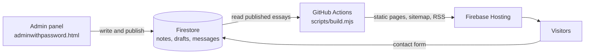

# Sharath Kumar Gunti: personal site

[](https://github.com/sharathkumargunti/sharathkumargunti/actions/workflows/firebase-hosting-merge.yml)
[](LICENSE)


A fast, no-framework personal website with a home page, a notes and essays section, and a private admin panel for writing. Live at **[sharathkumargunti.web.app](https://sharathkumargunti.web.app)**.

Essays are written in the browser, stored in Firestore, and turned into real static pages on every deploy, so each essay has its own address, title, summary and link preview.

> **Code is MIT. Personal content is not.** The code is free to reuse. My name, photo, images, bio and essays are © Sharath Kumar Gunti and are not licensed for reuse. See [License](#license).

## Contents

- [Features](#features)
- [How it works](#how-it-works)
- [Tech stack](#tech-stack)
- [Project structure](#project-structure)
- [Run it locally](#run-it-locally)
- [Set up your own copy](#set-up-your-own-copy)
- [Make it yours](#make-it-yours)
- [Writing and publishing](#writing-and-publishing)
- [Security](#security)
- [Troubleshooting](#troubleshooting)
- [Contributing](#contributing)
- [License](#license)

## Features

- **Notes and essays.** One real HTML page per essay, with its own title, description and social card. Links look right on WhatsApp, X, Telegram and Google.
- **Search.** A search box on the notes page. The search index is loaded only when it is used.
- **RSS and sitemap.** `rss.xml` and `sitemap.xml` are generated on every deploy.
- **Admin panel.** Write in Markdown, preview, autosave drafts, edit slug and summary, publish, unpublish, and read messages from visitors.
- **Contact messages.** Visitors can leave a message. Only admins can read it.
- **Light and dark themes**, a web app manifest and icons for home-screen install.
- **Privacy-friendly analytics.** Firebase Analytics on public pages only, skipped for visitors who send Do Not Track or Global Privacy Control, and easy to switch off.
- **Safe deploys.** If the build fails, the workflow turns red and the live site keeps its previous version.

## How it works



1. You write and publish in the admin panel. Everything is saved in Firestore (`notes`, `drafts`, `messages`).
2. A deploy runs `scripts/build.mjs`. It reads the published essays and writes `essays/<slug>.html`, `notes-index.json`, `search-index.json`, `sitemap.xml` and `rss.xml`. It also fills the essay list into `notes.html` and the latest essay into `index.html`.
3. The result is uploaded to Firebase Hosting.

A deploy starts when you:

- push to `main`,
- wait for the schedule (every 6 hours),
- press **Deploy site** in the admin panel (needs the optional token, see [setup](#set-up-your-own-copy)), or
- press **Run workflow** on the GitHub Actions tab.

The generated files are listed in `.gitignore` and are never committed.

## Tech stack

| Part | Choice |
| --- | --- |
| Front end | Plain HTML, CSS and JavaScript (ES modules). No framework, no bundler |
| Data and auth | Firebase Authentication (email and password) and Firestore |
| Hosting | Firebase Hosting |
| Build | Node 20 or newer (CI uses 22) with `marked`, `DOMPurify` and `jsdom` |
| CI/CD | GitHub Actions |

## Project structure

| Path | What it is |
| --- | --- |
| `index.html`, `notes.html`, `404.html` | The public pages |
| `adminwithpassword.html` | Admin panel. Protected by Firebase sign-in and `firestore.rules`, not by being hidden |
| `assets/firebase-config.js` | **The one place for Firebase settings and site-wide switches** |
| `assets/util.js` | Slugs, excerpts and page markup shared by the browser, the admin panel and the build |
| `assets/site.css`, `assets/base.css` | Styles, including shared accessibility rules |
| `assets/home.js`, `notes.js`, `essay.js`, `article.js`, `site.js`, `firebase.js` | Page scripts. Firebase is loaded only when needed |
| `scripts/build.mjs`, `scripts/build.test.mjs` | The pre-render build and its tests |
| `firestore.rules` | Security rules. Paste them into the Firebase console (not deployed automatically) |
| `firebase.json`, `.firebaserc` | Hosting settings, security headers, clean URLs and cache rules |
| `.github/workflows/`, `.github/actions/build-site/` | Deploy on merge, preview on pull request, and the shared build step |
| `profile_photo.jpg`, `og-default.png`, icons, `favicon.svg`, `site.webmanifest` | Images and app metadata |

## Run it locally

You need Node 20 or newer.

```bash
git clone https://github.com/sharathkumargunti/sharathkumargunti.git
cd sharathkumargunti
npm install
npm test            # checks the build code
npm run build       # optional: pre-renders essays (reads published notes from Firestore)
python3 -m http.server 8000
```

Open `http://localhost:8000/index.html` and `/notes.html`. Clean URLs such as `/notes` only work on Firebase Hosting.

`npm run build` rewrites `index.html` and `notes.html`. Run `git checkout index.html notes.html` afterwards if you do not want to keep those changes.

## Set up your own copy

You need your own Firebase project and your own GitHub repository. Nothing here connects to mine.

**1. Copy the code.** Fork or clone this repository and push it to your own GitHub account.

**2. Create a Firebase project.** In the Firebase console:

- Add a **web app** and copy its settings.
- Enable **Authentication** with the Email/Password provider, and add your own account under Users.
- Create a **Firestore Database**.
- Set up **Hosting** and note your site name.

**3. Point the code at your project.**

- `assets/firebase-config.js`: replace `firebaseConfig`, and set `SITE.url`, `SITE.name` and, if you want a mail icon on the home page, `SITE.contactEmail`.
- `.firebaserc`: your project ID.
- `firebase.json`: set `hosting.site` to your Hosting site name.
- `.github/workflows/*.yml`: set `projectId`, and change the secret name to match yours (next step). Do this in both workflow files.

**4. Create the deploy secret.** Run `firebase init hosting:github` in your clone and let it create the service-account secret in your GitHub repository. Keep the workflow files from this repo. Only the secret matters. Never commit a service-account JSON file.

**5. Make yourself an admin.** The admin panel only works for accounts listed in Firestore.

1. Firebase console > Authentication > Users: copy your **User UID**.
2. Firestore Database > start a collection named `admins` and add one document. The document ID is the UID. Give it any field, for example `role` = `admin`.

**6. Publish the security rules.** Firebase console > Firestore Database > Rules: paste the contents of `firestore.rules` and press **Publish**. Do step 5 first, or you will lock yourself out of publishing.

**7. Push to `main`.** Open the Actions tab. The first run installs the build tools and takes about a minute. Then open `/notes` and one essay under `/essays/`.

**8. Restrict the API key (recommended).** Google Cloud console > APIs & Services > Credentials > the browser key > Websites restriction. Allow your Hosting addresses (`https://YOUR-SITE.web.app/*` and `https://YOUR-SITE.firebaseapp.com/*`) and `http://localhost:*`. The build sends your site address as its referrer, so it is not blocked.

**9. Optional: enable the Deploy button.** GitHub > Settings > Developer settings > Fine-grained tokens. Repository access: only your repo. Permission: **Actions: Read and write**. Then open the admin panel, go to the Notes tab, press the gear next to **Deploy site**, and enter `owner/repo` and the token. They are stored in that browser only. After that, publishing, updating, unpublishing and deleting start a deploy by themselves.

## Make it yours

Replace everything that is personal to me:

- Images: `profile_photo.jpg`, `og-default.png`, `icon-192.png`, `icon-512.png`, `apple-touch-icon.png`, `favicon.svg`.
- Text and links: the bio, social profiles and structured data in `index.html`, and the names in `site.webmanifest`.
- Site address: `https://sharathkumargunti.web.app` is also written by hand in the `<head>` of `index.html` and `notes.html`, and in `robots.txt`. Change it there and in `assets/firebase-config.js`. Do the same if you add a custom domain.
- Delete `googlefee425d75b6a786f.html`. It verifies my site with Google Search Console and does nothing for yours.
- Analytics: set `analytics: false` in `assets/firebase-config.js` to switch it off completely.

## Writing and publishing

- Write in the admin panel. Drafts autosave and stay private.
- Each essay has a **Link** (slug) and a **Summary** field. Changing the link of a published essay keeps the old address working.
- Unpublishing and publishing again keeps the same address and original date.
- After publishing, wait about 2 minutes for the deploy, then share the link (`Copy Link` in the essay menu). Before the deploy finishes, the link opens the essay but link previews are generic, and WhatsApp remembers what it saw first.
- Unpublishing or deleting an essay takes effect at the next deploy.

## Security

- **Firebase web keys are not secrets.** They only identify the project. Your data is protected by `firestore.rules`, and by restricting the key to your domains.
- **What the rules allow.** Anyone can read published essays. Only admins can create, edit or delete essays and read drafts. Visitors can create a well-formed message (name up to 100 characters, text up to 2,000) but cannot read any. Admin accounts are listed in the `admins` collection and cannot be edited from the client.
- **No secrets in this repository.** The deploy credential is a GitHub Actions secret. The optional Deploy-button token is stored only in your browser. Never commit service-account files, tokens or `.env` files.
- **Fork pull requests** do not get preview deploys, because they cannot read repository secrets.
- **Found a vulnerability?** Please use this repository's **Security** tab > **Report a vulnerability** so it stays private until fixed.

## Troubleshooting

| Problem | What to check |
| --- | --- |
| Build fails with **403** | The rules do not allow public reads of `notes`, or the API key's website restriction does not include your site address |
| Admin panel says you cannot publish | Your UID is not in the `admins` collection, or the rules are not published |
| Scheduled deploys stopped | On public repositories GitHub disables scheduled workflows after 60 days without repository activity. Re-enable it on the Actions tab, or push any commit |
| A new essay is missing | Wait for the deploy to finish. A failed build keeps the previous version live, so check the Actions tab |
| Link preview looks generic | The deploy has not finished yet. WhatsApp caches what it saw first, so wait and share a new link |

## Contributing

Bug reports and pull requests are welcome. Please open an issue first for larger changes. Run `npm install && npm test` before opening a pull request.

## License

- **Code:** [MIT](LICENSE).
- **Personal content** (name, photo, images, icons, bio text and essays): all rights reserved. Please do not reuse it.
